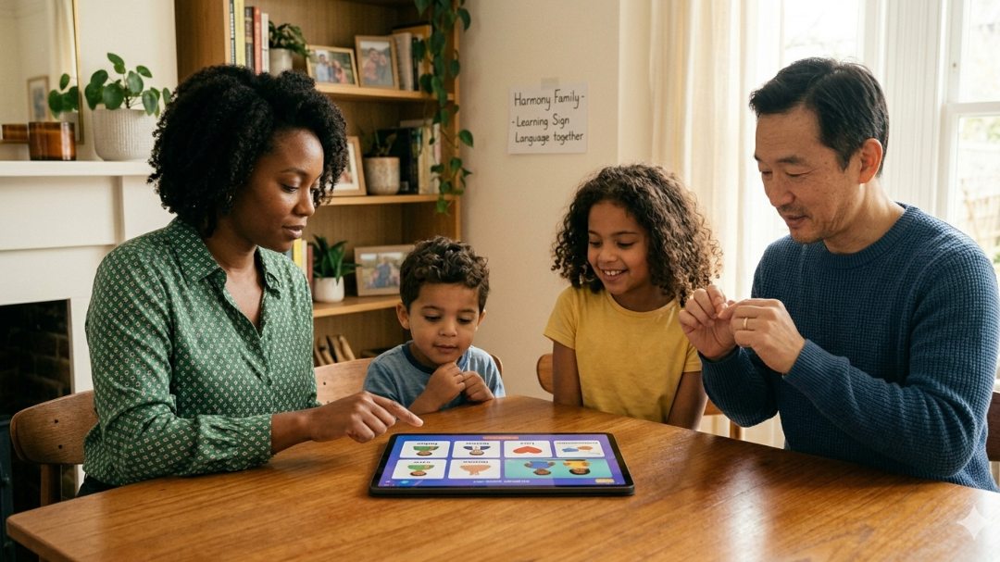
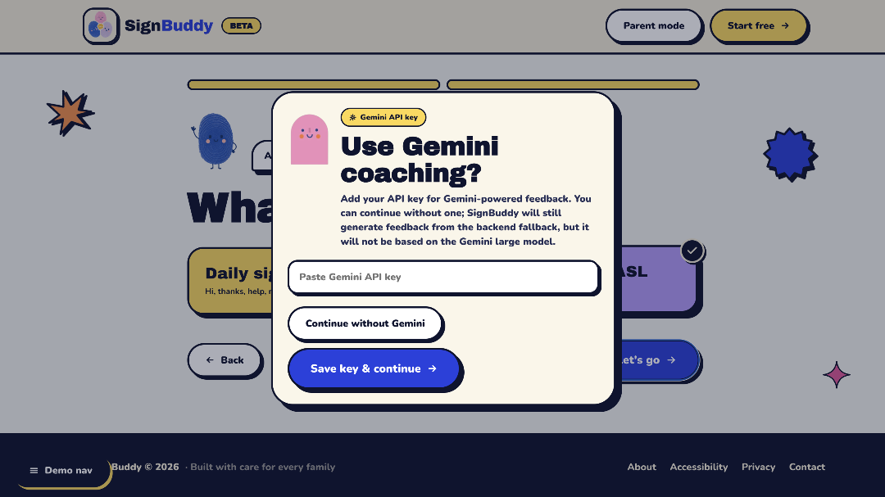

Hearing families often have ASL *content* (videos, flashcards) and almost no *feedback*. SignBuddy is built around Watch → Sign → Recognize → Feedback → Retry. The tablet scene above is the intended use: parents and kids practicing everyday signs at home. It is a product still, not evidence from a user study.

## The solution in one sentence

**Our solution is a teaching pipeline that reuses the strongest public isolated-sign recognizer**, then adapts webcam/WLASL video into the competition landmark contract and constrains the vocabulary for learners.

```
video → MediaPipe Holistic (543 points / frame)
     → 1D CNN + Transformer (ISLR 1st-place graph)
     → top-k among 25 everyday signs
     → optional Gemma 4 coaching
```

The backbone is [hoyso48's 2023 ISLR writeup](https://www.kaggle.com/competitions/asl-signs/writeups/hoyeol-sohn-1st-place-solution-1dcnn-combined-with): 1D CNN as a trainable tokenizer for strong frame-to-frame correlation, Transformer only for longer range. His **participant-split** numbers (about **0.80 CV / 0.80 public / 0.88 private** on **250** classes) are the baseline we adopted. They are not a score we posted on 25 signs.

What we added:

1. **Domain.** Video has to become the same `(T, 543, 3)` parquet geometry the recognizer expects.
2. **Product constraint.** A 250-way ensemble is masked at inference to 25 daily signs (`apple`, `book`, `bye`, … `yes`) so a beginner app does not emit contest vocabulary.
3. **Task.** Gemma 4 is a coach, not the classifier. It reads top-k JSON (label, probability, confidence, learner goal, past errors). It does not see pixels or joints.

Hackathon writeup: [ASL Gesture Recognition and Coaching](https://www.kaggle.com/competitions/gemma-4-good-hackathon/writeups/new-writeup-1775960783214). Code: [sx2660-png/ASL](https://github.com/sx2660-png/ASL) (inference API) and [sx2660-png/signbuddy](https://github.com/sx2660-png/signbuddy) (this UI).

## Why this backbone, not an LSTM we trained in a weekend

ISLR already answered CNN vs Transformer, padding vs truncation, causal depthwise conv so masks do not leak, and TFLite as a deployment constraint (he moved PyTorch → TensorFlow + Colab TPU). Re-deriving a weaker net would not be the engineering. The remaining risk is **domain shift** (competition parquet vs our MediaPipe Tasks extract) and **vocabulary mismatch** — those are the things to measure next.

I do not say "we won ISLR" or "our model is 0.88."

## Gemma is optional on purpose



The live UI asks whether to turn on Gemini coaching. Without a key, recognition still runs; coaching falls back and is **not** the Gemma model. That matches the API: `/predict*` works without `GEMINI_API_KEY`; `/coach*` returns 503. Coaching is a layer on top of the classifier, not the thing that finds the hand.

## Honest gaps (do not skip in an interview)

- No published 25-class top-1 / top-3 on a **signer-split**.
- A self-recorded eval dump of 22 clips was all `ERROR`, and some filenames were outside the 25-sign map (`friend`, `thank_you` vs `thankyou`). That is a broken harness, not a reported accuracy.
- Public `main` loads four ISLR `.h5` seeds; it does not contain a training loop or a `.tflite` export yet (even though on-device was the original PopSign/ISLR constraint).
- The coach cannot say "raise the hand" until the payload includes geometry, not only top-k words.

Next measurements I would run: lock the 543-point contract with tests, then 25-sign participant-split top-1/top-3, then TFLite numerical parity with the Keras graph.
